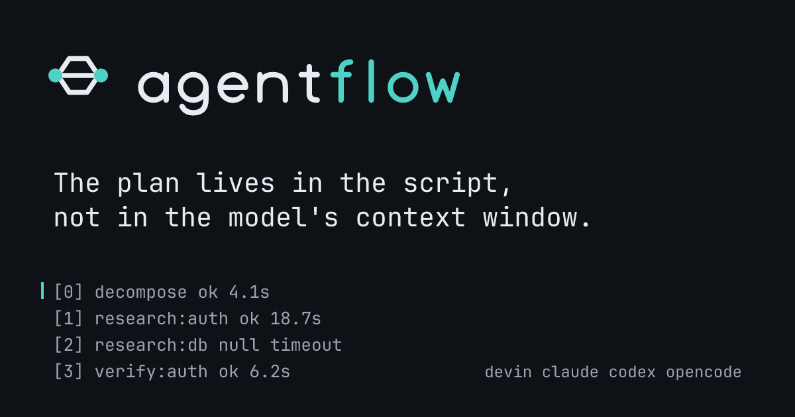
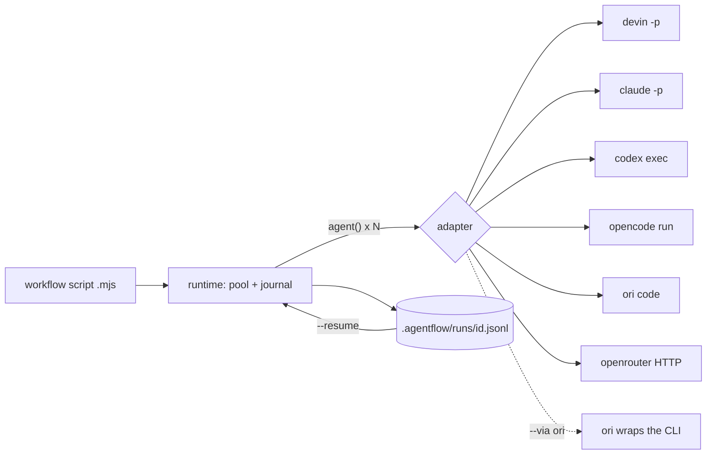

<p align="center">
  <picture>
    <source media="(prefers-color-scheme: dark)" srcset="assets/brand/wordmark-dark.svg">
    
  </picture>
</p>

<p align="center"><b>Write a multi-agent workflow once as a script, then run it on <code>devin</code>, <code>claude</code>, <code>codex</code> or <code>opencode</code>.</b></p>

agentflow is a small Node runner. A workflow is an `.mjs` file; each `agent()`
call spawns one non-interactive CLI session of the harness you pick, under a
bounded concurrency pool, and every settled result is journaled so a run can be
resumed. The plan lives in the script, not in a model's context window. This is
the same idea as Claude Code's [dynamic workflows](https://code.claude.com/docs/en/workflows),
delivered as a portable subprocess runner.



> The image is a design proposal with illustrative log lines, not a capture.
> TODO: replace with a real terminal recording of `agentflow tail` on a live run (needs paid or free-tier model calls, so it was not recorded here).

## Install

Requires Node 20 or newer.

```bash
npm install -g @lukedaduke/agentflow   # or: npx @lukedaduke/agentflow
agentflow doctor                     # which harness CLIs are on PATH
```

From a clone instead:

```bash
git clone https://github.com/duketopceo/agentflow
cd agentflow
bin/agentflow doctor
```

### As an agent plugin

const results = await parallel(files.map((f) => () =>
  agent(`Review ${f}`, { label: `review:${f}`, model: "cheap" })
));

const good = results.filter(Boolean);
```

Globals inside a script: `agent()`, `parallel()`, `pipeline()`, `batch()`,
`phase()`, `log()`, `args`. `batch()` fans out through the harness's async
surface — one OR Batch job on `--harness openrouter` (~40–60% cheaper),
one Devin Cloud session per item on `--harness devin` (`swe-2` models are
free), one async sonar request per item on `--harness perplexity`
(grounded, cited answers — the research surface), or first-party batch APIs
on `--harness openai`/`--harness anthropic` (~50% off, 24h window). Results
align to input order; resumable mid-poll.

## Watching a run

`agentflow watch [run-id]` renders a live per-lane view from the run journal —
spinning in-flight lanes, batch poll progress, per-call token counts, orphan
detection — on an alternate screen. Piped output falls back to `tail`-style
event lines; `status <id>` prints the same totals for scripts. Token usage
is journaled per call on harnesses that report it (devin, via `--export`)
and summed in `status`/`watch`.

## Install as an agent plugin

The repo carries a manifest for each harness; all resolve to the shared
`skills/agentflow/` directory.

| Harness | Install |
|---|---|
| Devin | `devin plugins install -y duketopceo/agentflow` (or `--local /path/to/agentflow`) — reads `.devin-plugin/`; auto-installs the compound-engineering plugin via `requiredPlugins` |
| Claude Code | `claude plugin marketplace add duketopceo/agentflow` then `claude plugin install agentflow@agentflow` → `.claude-plugin/` (live-verified); MCP via `claude mcp add agentflow --scope user -- agentflow mcp` — though inside Claude, prefer the native Workflow tool |
| Codex | `codex plugin marketplace add duketopceo/agentflow` then `codex plugin add agentflow@agentflow` → `.codex-plugin/` (live-verified); MCP via `codex mcp add agentflow -- agentflow mcp` |
| OpenCode | v1 `1.18.29+`: `opencode plugin github:duketopceo/agentflow` → `plugins/agentflow/v1.mjs` (live-verified). v2: verified on `opencode-ai@beta` (`0.0.0-beta-202608110357`) — plugin installs, `agentflow_run`/`agentflow_doctor` register and execute. See `.opencode/INSTALL.md` |
| Factory Droid | `droid plugin marketplace add duketopceo/agentflow` — `.factory-plugin/` native (`.claude-plugin/` also auto-translates); ships the `worker` droid |
| Copilot CLI | `copilot plugin install duketopceo/agentflow` (verified: skill installs); MCP via `copilot mcp add agentflow -- agentflow mcp` |
| Cursor | `.cursor-plugin/` native; **listed at [cursor.directory/plugins/agentflow](https://cursor.directory/plugins/agentflow)**; official marketplace publisher application submitted (manual review) — root `plugin.json` also covers the open standard |
| Gemini CLI | `gemini extensions install https://github.com/duketopceo/agentflow` — verified live: `gemini mcp list` shows `agentflow` connected |
| Any MCP client | `agentflow mcp` — the `.mcp.json` at repo root wires it (Crush, Claude Desktop, Zed, Roo, Kiro…). Tools: `agentflow_run`/`doctor`/`status`/`tail`/`stop` |
| Ori/OpenRouter/Perplexity | no plugin surface — run `agentflow` CLI directly with `--harness ori` / `--harness openrouter` / `--harness perplexity` or `--via ori` |

<sub>Devin, OpenCode v1, Claude Code, Codex, Gemini (extension + MCP server), the universal
skills registry, and Copilot rows are live-verified; Factory/Cursor rows are
manifest-verified (GUI/no-binary installs). Published to npm as
[`@lukedaduke/agentflow`](https://www.npmjs.com/package/@lukedaduke/agentflow) — the plugin
manifests above (or `npm i -g`) are the install paths.</sub>

## Quick start

No model calls, no cost:

```bash
bin/agentflow run examples/parallel-audit.mjs --harness echo
```

Real harness, cheap model (see `docs/smoke-matrix.md` for tested combinations):

```bash
bin/agentflow run workflows/deep-research.mjs --harness devin -- "your question"
bin/agentflow run workflows/deep-research.mjs --harness openrouter --cache -- "your question"   # needs OPENROUTER_API_KEY
bin/agentflow run my-workflow.mjs --harness claude --via ori -- args   # claude workers billed through OpenRouter
```

A workflow script has top-level `await` and these globals: `agent`, `parallel`,
`pipeline`, `phase`, `log`, `args`.

```js
export const meta = { name: "audit", description: "review every file", phases: ["fan-out"] };

phase("fan-out");
const results = await parallel(files.map((f) => () =>
  agent(`Review ${f}`, { label: `review:${f}`, model: "cheap" })
));
const good = results.filter(Boolean);   // a failed call is null, not an exception
```

Commands: `run`, `status <run-id>`, `tail <run-id>`, `list`, `doctor`.
Useful flags: `--harness`, `--concurrency`, `--via ori`, `--cache`, `--resume <run-id>`,
`--retries`, `--max-agents`, `--strict`, `--detach`.

## How it works



- **Cross-harness** means: one script, and a thin adapter per CLI that builds
  argv, spawns the process, classifies failure (timeout, permission denial) and
  parses output into `{text, json}`. Sessions, tools and context are not shared;
  workers share only the filesystem.
- **Journal:** each settled call is one line in `.agentflow/runs/<run-id>.jsonl`.
  `--resume` replays settled calls by call order, so keep `agent()` call order
  stable. `--cache` memoises by content (prompt, model, schema, ...) instead.
- **Limits you should know:** no sandbox beyond what each CLI enforces, no
  usage/cost numbers in the journal, schema output is validated by prompt and
  extraction only (native on codex), and `--resume` does not yet check that a
  prompt is unchanged (ROADMAP U3).

## Ops

```bash
bin/agentflow run w.mjs --detach   # background; journal keeps the record
bin/agentflow status <run-id>      # progress; 'orphaned' if the pid died
bin/agentflow stop <run-id>        # SIGTERM the journaled pid (resumable)
bin/agentflow clean [--all]        # reclaim worktrees of non-live runs (force!)
node scripts/smoke-harnesses.mjs   # reproducible live-adapter matrix
```

Ops commands are cwd-rooted — run them from the directory you ran `run`
from. `clean` force-removes worktrees (ended *and* orphaned runs): harvest
agent work first.

`agent(p, {worktree: 'auto'})` runs the call in its own `git worktree` under
`.agentflow/worktrees/` — isolates file-mutating agents from the main
checkout; `clean` reclaims them after the run ends.

## Docs

- `skills/agentflow/SKILL.md` — agent-facing guidance (installed per harness)
- `docs/plans/` — design history and the [program roadmap](docs/plans/2026-10-10-005-feat-program-roadmap-plan.md)
- `docs/smoke-matrix.md` — live per-adapter verification results (`scripts/smoke-harnesses.mjs` reproduces)
- `docs/research/` — cross-harness landscape + orchestration economics; start with `2026-10-10-landscape.md`
- `docs/publish-matrix.md` — per-harness distribution surfaces and publish paths
- `DESIGN.md` and `assets/brand/` — design direction and logo proposal

## Status

Early development, v0.2. Plans and priorities are in [ROADMAP.md](ROADMAP.md).

## Contributing

Run `node --test`. Keep changes small and add a test for adapter behaviour; see
`docs/solutions/agent-orchestration/` for the invariants (notably that every
`spawnAgent` override must call `applyVia`). Open a PR; the default branch is
protected.

## License

AGPL-3.0. Free to use and modify, including privately. If you host or distribute a modified version, you must publish your source under the same license. See [`LICENSE`](LICENSE).

Versions of this repository before the AGPL-3.0 change were published under the MIT License, and those copies remain available under MIT.
