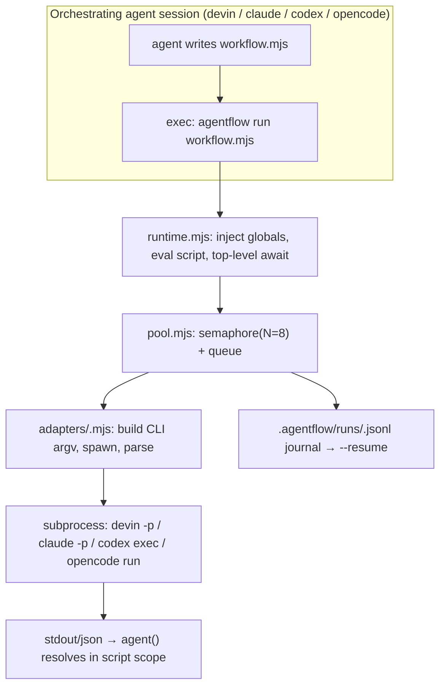
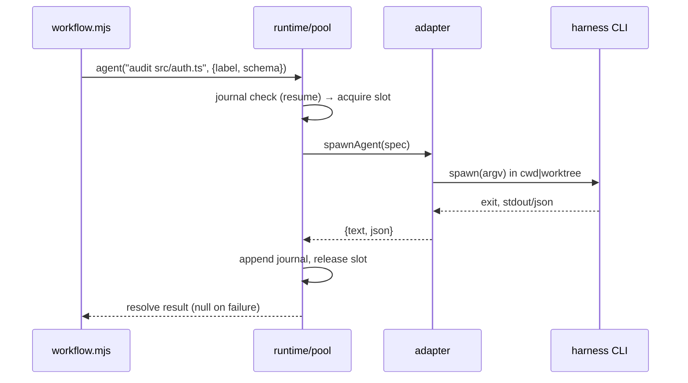

**Target repo:** `agentflow` (new repo under `duketopceo`, created by U1). All file paths below are relative to that repo root.

# Agentflow: Cross-Harness Dynamic Workflows - Plan

## Goal Capsule

- **Objective:** An agent running in Devin CLI (and equally in OpenCode, Claude Code, or Codex) can turn a large task into a saved, rerunnable orchestration script that fans out dozens of parallel subagent sessions, holds intermediate results in script variables, and returns only a final answer to the orchestrator's context — matching the capability shape of Claude Code's dynamic workflows.
- **Means:** a zero-dependency Node.js CLI (`agentflow`) that executes a JavaScript workflow script with injected globals (`agent()`, `parallel()`, `pipeline()`, `phase()`, `log()`), each `agent()` call spawning a one-shot harness CLI session as a subprocess; distributed from one repo as a multi-manifest plugin with a per-harness skill (KTD1, KTD2, KTD5).
- **Authority hierarchy:** this plan → `~/bin/gh-new-repo` conventions → Devin CLI docs (permissions, subagents, plugins) → each harness's `--help` surface.
- **Execution profile:** normal code path — branch, tests, PR.
- **Stop conditions:** a named harness CLI cannot run non-interactively with tool approval handled (plan's feasibility premise fails); unit tests cannot pass without real-model calls.
- **Who finishes:** `ce-work` implements; `lfg` pipeline ships to PR.

---

## Product Contract

### Summary

Build `agentflow`, a small standalone runner that mirrors Claude Code's dynamic-workflows feature for harnesses that lack it. An orchestrating agent writes a JS script; the runner executes it with a concurrency pool, spawning one-shot CLI agent sessions as subprocesses and returning structured results into script variables. The repo ships per-harness skills that teach each agent when to reach for it and how to write the scripts, packaged so `devin plugins install`, Claude's plugin loader, Codex, and OpenCode can each pick it up from the same repository.

### Problem Frame

Claude Code's dynamic workflows moved orchestration into code: a script holds the loop, the branching, and intermediate state, while a runtime pools tens-to-hundreds of subagents. Devin, Codex, and OpenCode can each fan out subagents, but only turn-by-turn through the orchestrating model's context — which caps parallelism, loses rerunnability, and puts every intermediate result on the orchestrator's token bill. On this machine all four CLIs are installed (`devin` 3000.11.3, `claude` 2.1.292, `codex` 0.160.1, `opencode` 1.18.33), and each has a documented non-interactive mode, so the substrate exists; what is missing is the executor and the shared script contract.

### Requirements

**Runner core**

- R1. `agentflow run <script.mjs>` executes a workflow script with top-level `await`, exposing `agent()`, `parallel()`, `pipeline()`, `phase()`, `log()`, and an `args` global.
- R2. Each `agent()` call spawns one one-shot session of the configured harness CLI as a subprocess and resolves to that agent's final result, or `null` on unrecoverable failure — matching Claude's `agent()` semantics.
- R3. Agent calls run under a bounded concurrency pool (default 8, configurable via flag and `agentflow.json`), with calls beyond the limit queued. `agentflow.json` supports a per-harness `maxConcurrency` override (conservative defaults — e.g., 4 for `devin`) since account-level parallel-session limits are unverified.
- R4. `agent()` options accepted per call: `{ label, model, schema, worktree, cwd, timeout, permission, sandbox }`; unknown options warn rather than fail.
- R5. A journal at `.agentflow/runs/<run-id>.jsonl` records every settled `agent()` call including a hash of the call spec (prompt + options); `agentflow run --resume <run-id>` replays settled results only when the incoming call's spec hash matches, warning and re-executing on mismatch. On interrupt (SIGINT/SIGTERM), the runner stops dequeuing new calls, lets in-flight agents finish or kills them after a grace period, journals settled results, and exits leaving the run resumable.
- R6. When `schema` is passed, the runner returns parsed JSON for that agent: native structured-output flags where the harness has them, prompt-level instruction plus JSON extraction where it does not, `null` when parsing fails.

**Harness adapters**

- R7. One adapter per harness — `devin`, `claude`, `codex`, `opencode` — mapping the generic spawn spec to that CLI's flags per the capability matrix in Sources & Research, plus an `echo` adapter that returns a canned response for tests.
- R8. Harness selection is per-run (`--harness` flag, config default `devin`); a script may not mix harnesses in v1.
- R9. Each adapter defaults to that harness's least-privileged unattended mode (per KTD7); escalation is an explicit per-call or per-run option.
- R10. `agentflow doctor` reports which harness CLIs are on PATH and verifies the flags the adapter relies on exist (`--version`/help probes), reports the running Node version against the `engines.node >= 20` requirement, and exits non-zero on failure.

**Distribution**

- R11. The repo installs as a plugin in each target harness: Agent Plugins root `plugin.json` + `.devin-plugin/` for Devin, `.claude-plugin/` for Claude, `.codex-plugin/` for Codex, `.opencode/` for OpenCode.
- R12. A `skills/agentflow/SKILL.md` teaches every harness the trigger conditions (fan-out beyond a handful of agents, codified rerunnable orchestration, adversarial/verification passes), the script API, cost guidance, and how to run/resume.
- R13. `examples/` contains runnable workflow scripts (parallel audit, multi-angle research) that run against the `echo` adapter with no model spend, plus one opt-in live smoke example guarded behind an explicit flag.

### Scope Boundaries

- **Out of scope (v1):** mixing harnesses inside one script; a TUI/dashboard for watching runs; `devin --cloud` sessions as agents; an OpenCode-native custom tool registration; editing any harness's internals.
- **Deferred to follow-up work:** CE-converter pipeline for emitting per-harness formats mechanically; OpenCode plugin-registered `workflow` tool; `devin --cloud` adapter variant; npm/binary distribution beyond the repo checkout.

### Key Decisions

- **Cross-harness plugin in its own repo** (session-settled: user-directed — chosen over config inside an existing repo: user asked for portability across Devin, OpenCode, Claude, Codex). Governs R11, R12.
- **All four harnesses in v1** (session-settled: user-directed — chosen over Devin-only: user named the harness set). Governs R7, R8.
- **Feasibility is settled, not probed** (session-settled: user-directed — user conditioned the project on "if that's possible"; every named harness's non-interactive surface was verified this session — see Sources & Research). Governs the project existing at all.

### Success Criteria

- `agentflow run examples/parallel-audit.mjs --harness echo` completes a multi-agent script locally with zero model spend.
- A real `devin -p`-backed workflow completes end-to-end on this machine (manual smoke — costs tokens, run once).
- `devin plugins install --local <repo>` exposes `/agentflow:*` skills; `claude`, `codex`, and `opencode` each see the skill/agent surface through their own plugin formats.

### Actors

- A1. **Orchestrating agent** — a Devin/Claude/Codex/OpenCode session that writes and launches the script; holds only the final result.
- A2. **Workflow agent** — a spawned one-shot CLI session; sees only its prompt, works in the given `cwd`/worktree.
- A3. **Operator** — the human who installs the plugin, runs `doctor`, picks models, and reads reports.

---

## Planning Contract

### Key Technical Decisions

- KTD1. **Subprocess fan-out is the execution model.** Each `agent()` spawns a one-shot harness CLI (`devin -p`, `claude -p`, `codex exec`, `opencode run`) rather than calling an SDK or API. This is the only mechanism that works identically across all four harnesses today, gives each agent a genuinely clean context, and inherits the harness's own auth, sandboxing, and permission model. Rejected alternatives: in-process subagent pools (no such API exists outside Claude), harness-specific SDKs (four integrations to maintain, uneven coverage), a skill that only teaches ad-hoc scripting (no rerunnable, journaled, verified artifact).
- KTD2. **Mirror Claude's workflow script API.** Globals: `agent(prompt, opts)`, `parallel(tasks)`, `pipeline(items, fn)`, `phase(name)`, `log(msg)`, `args`, and `export const meta = { name, description }`. Same names, same `null`-on-failure contract, so scripts port between Claude Code and agentflow with minimal edits. Rejected: inventing a divergent API (loses the main benefit — familiarity and portability of scripts Claude can already write).
- KTD3. **Zero-dependency Node.js, single CLI entry.** Plain `node` ESM, no npm packages: `bin/agentflow` → `src/*.mjs`. Node is present wherever these harnesses run; the workflow scripts are JavaScript by definition (KTD2), so a JS host avoids an embedded engine. Rejected: Python (would need a JS engine to host the scripts), Bun (not universally installed; CE-plugin parity is nice-to-have, not load-bearing).
- KTD4. **Adapter contract: `spawnAgent(spec) → Promise<{text, json?, exitCode, stderrTail}>`.** Spec fields map to the per-harness matrix below; each adapter owns flag mapping and output parsing (stdout text; harness-native JSON where available — `codex --output-schema`, `claude --json-schema`, `opencode --format json`; Devin falls back to prompt-instructed JSON extraction).
- KTD5. **One repo, multi-manifest packaging.** Root `plugin.json` (Agent Plugins 1.0.0 — Devin loads this spec natively), plus `.devin-plugin/plugin.json`, `.claude-plugin/plugin.json`, `.codex-plugin/plugin.json`, `.opencode/` following the compound-engineering repo's proven layout. No converter build step in v1 — the per-harness manifests are thin enough to author directly. Rejected: depending on the CE converter CLI (extra build tooling for four small JSON files).
- KTD6. **Journal-based resume.** Append-only JSONL per run keyed by call sequence index; each entry also records a hash of the call spec (prompt + options). `--resume` replays a journaled result only when the incoming call's spec hash matches; on mismatch the runner warns on stderr and re-executes that call rather than replaying a stale result. Deterministic call ordering remains a script-authoring discipline (documented: avoid `Date.now()`/`Math.random()` in call ordering — same constraint Claude imposes) — the hash check detects drift rather than silently replaying wrong results.
- KTD7. **Least-privilege default per harness.** Devin: `--permission-mode smart` (auto-approves judged-safe, prompts never reach a headless run — denial is surfaced as failure); Codex: `-s workspace-write`; OpenCode: no `--auto` unless the script author sets it; Claude: `--allowedTools` restricted to read-only set by default. Escalation (`--permission-mode dangerous`, `danger-full-access`, `--auto`, broad tools) is an explicit `agent()` option — but clamped by a run-level permission ceiling (`--permission` flag on `agentflow run`, configurable in `agentflow.json`, default `smart`/least-privilege): a script requesting `escalated` above the run ceiling warns and is clamped, so the operator's opt-in is real rather than delegated to the script author. Trust boundary: the runner executes workflow scripts with the operator's full ambient privileges — `AsyncFunction`/`node:vm` is an execution convenience, not a security boundary — and the read-before-run rule applies equally to agent-generated scripts that may embed untrusted input (repo files, web content, or prior agents' result text).
- KTD8. **The skill is the trigger, the runner is the engine.** Capabilities (pooling, journaling, schema extraction, worktrees) live in `agentflow`; the SKILL.md carries the judgment — when fan-out beats `run_subagent`-style delegation, how to write the script, cost guidance (cheap models for mechanical extraction, expensive for judgment — matching the user's spend ceiling). This mirrors the division Claude uses (`ultracode` intent → Workflow tool execution).

### High-Level Technical Design





### Assumptions

- **Subprocess fidelity accepted.** Intermediate results travel via process stdout/files, not an in-process pool like Claude's Workflow runtime — the closest achievable mirror without harness internals (surfaced as a call-out; user proceeded via lfg).
- **Claude gets an adapter too**, despite native workflows existing — uniform interface and cross-harness scripts justify it; the skill notes native `Workflow` is preferable inside Claude sessions.
- **Repo named `agentflow`**, private, under `duketopceo`, created via `~/bin/gh-new-repo` (user standard).
- **Codex participates with thinner control** — `codex exec` lacks custom subagent definitions, but `-m`, `-c` config overrides, `--output-schema`, `--json`, and `--worktree` cover the contract.
- **Plan file home:** this document lives in the parent workspace (`docs/plans/` beside the repo dir) because the target repo does not exist until U1; U1 moves or copies it into the repo's `docs/plans/` as the founding plan.

### Output Structure

```text
agentflow/
├── plugin.json                  # Agent Plugins 1.0.0 root manifest
├── .devin-plugin/plugin.json    # Devin manifest (wins over claude/agent-plugins)
├── .claude-plugin/plugin.json
├── .codex-plugin/plugin.json
├── .opencode/INSTALL.md         # opencode setup notes (no manifest format needed for skills)
├── bin/agentflow                # node shebang wrapper → src/cli.mjs
├── src/
│   ├── cli.mjs                  # run / list / doctor commands
│   ├── runtime.mjs              # script eval + injected globals + args
│   ├── pool.mjs                 # concurrency semaphore + queue
│   ├── journal.mjs              # append-only run journal + replay
│   ├── schema.mjs               # schema → prompt instruction + extractor
│   ├── worktree.mjs             # git worktree lifecycle + cleanup
│   └── adapters/
│       ├── base.mjs             # spawnAgent contract, shared spawn helper
│       ├── echo.mjs             # test adapter (no model spend)
│       ├── devin.mjs
│       ├── claude.mjs
│       ├── codex.mjs
│       └── opencode.mjs
├── skills/agentflow/SKILL.md    # trigger conditions + API + cost guidance
├── examples/
│   ├── parallel-audit.mjs
│   ├── multi-angle-research.mjs
│   └── devin-smoke.mjs          # opt-in live run (--harness devin --live)
├── tests/
│   ├── pool.test.mjs
│   ├── journal.test.mjs
│   ├── adapters.test.mjs        # argv construction per harness, fixture JSONL parsing
│   ├── runtime.test.mjs         # end-to-end via echo adapter
│   ├── schema.test.mjs
│   ├── worktree.test.mjs
│   └── fixtures/                # recorded harness JSON/JSONL outputs
├── agentflow.example.json       # config schema reference
├── package.json                 # type:module, bin, engines node>=20
└── README.md
```

---

## Implementation Units

### U1. Repo creation and scaffold

**Goal:** `duketopceo/agentflow` exists with standard protections, and the base layout is in place.

**Requirements:** R11 (partial — repo exists), project hygiene.

**Dependencies:** none.

**Files:**

- created via `~/bin/gh-new-repo agentflow --private -d "Cross-harness dynamic workflows: script-driven multi-agent orchestration for devin, claude, codex, opencode"`
- `package.json`, `.gitignore` (includes `.agentflow/` — run journals carry prompt and result text), `LICENSE` (MIT, matching CE convention), `README.md` skeleton, `docs/plans/` copy of this plan

**Approach:** run `gh-new-repo` from a fresh dir; the script applies branch protection, squash-only, fork-PR approval. Land the scaffold via the repo's normal PR flow; if `main` has no commits yet for a PR base, create the initial commit through GitHub/`gh` rather than a direct local push.

**Test expectation:** none — scaffolding.

**Verification:** `gh repo view duketopceo/agentflow` succeeds; protection applied per gh-new-repo output.

### U2. Runtime core

**Goal:** `agentflow run script.mjs` executes a JS workflow with the injected global contract.

**Requirements:** R1, R3, R5.

**Dependencies:** U1.

**Files:**

- `src/cli.mjs` — arg parsing (`run`, `list`, `doctor` subcommands; `--harness`, `--concurrency`, `--dir`, `--run-id`, `--resume <run-id>`, `--permission`, `--live` flags)
- `src/runtime.mjs` — reads script, wraps in async function with injected scope (`agent`, `parallel`, `pipeline`, `phase`, `log`, `args`), executes
- `src/pool.mjs` — promise-pool semaphore, FIFO queue, per-call timeout
- `src/journal.mjs` — JSONL append, keyed by call index; `resolveReplay()` returns settled results on resume
- `bin/agentflow` — `#!/usr/bin/env node` entry
- `tests/pool.test.mjs`, `tests/journal.test.mjs`, `tests/runtime.test.mjs`

**Approach:** inject globals by wrapping the script source in an async function context (`AsyncFunction` or `node:vm`) — no bundler needed. Because `export` is illegal inside a wrapped body, the runtime first statically extracts the `export const meta = {...}` literal (the same plain-object-literal constraint Claude documents) and strips it from the evaluated source, using `meta` for `list`/resume display. Static `import` is likewise illegal inside the wrapped body and unsupported in v1 — scripts needing a module use `await import()`; SKILL.md documents this. `agent()` enqueues onto the pool, calls the resolved adapter, returns `{text, json}` or `null`. `parallel()`/`pipeline()` are thin helpers over `Promise.all` with per-item `null` preservation (mirroring documented Claude semantics). Journal index = monotonic call counter per run; resume compares call sequence and replays only on spec-hash match per KTD6. Progress output — the no-TUI equivalent of Claude's `/workflows` view — is a human-readable stderr stream: `phase()`/`log()` lines plus one line per agent settle (`label`, ok/null, elapsed, model). Interrupt behavior per R5.

**Test scenarios:**

- Happy path: script calling `agent()` 5× via `echo` adapter completes; results array in order.
- Concurrency: 10 calls, `--concurrency 3` → max 3 in-flight at any moment (assert via fake-adapter delay + counter).
- `parallel()` preserves `null` slots when two of five agents fail.
- Journal: kill mid-run, `--resume` replays settled calls without respawning (assert adapter invocation count unchanged for settled indices).
- Interrupt: SIGINT mid-run with queued-but-unstarted calls → unsettled calls never spawn, journal holds settled results, `--resume` completes the run.
- Error path: script syntax error → clean failure message naming the script, non-zero exit.

**Verification:** `node --test tests/` passes; `bin/agentflow run examples/parallel-audit.mjs --harness echo` prints phase progression and final result.

### U3. Adapter contract + Devin adapter

**Goal:** the spawn spec → CLI argv mapping is defined once and implemented for the primary harness.

**Requirements:** R2, R4, R7 (devin + echo), R8, R9, R10.

**Dependencies:** U2.

**Files:**

- `src/adapters/base.mjs` — `spawnAgent(spec)` contract, shared `spawn` wrapper (capture stdout/stderr, timeout kill, cwd handling), plus the `probe()` contract each adapter implements for `doctor` (R10: binary present + required flags verified)
- `src/adapters/echo.mjs` — deterministic canned response, records spec for assertions
- `src/adapters/devin.mjs` — argv: `devin -p --respect-workspace-trust false --permission-mode <mapped> [--model X] [--sandbox]` in spec cwd/worktree; parse stdout as text result
- `tests/adapters.test.mjs` (devin + echo cases)

**Approach:** spec fields: `{prompt, label, model, schema, worktree, cwd, timeout, permission, sandbox}`. Devin mapping: `schema` → appended instruction "Respond with only JSON matching: <schema>" then JSON-extract from stdout; `worktree` → runner-managed `git worktree add` (U5 wires the flag through; this unit defines the adapter hook); `sandbox` → `--sandbox`. Permission mapping per KTD7: default `smart`, `escalated` → `dangerous`, clamped to the run-level ceiling. Adapters surface permission-denial and rate-limit failures distinctly in `stderrTail`.

**Test scenarios:**

- argv builder: each spec field produces the documented flag set (no spawn — pure function tests).
- JSON extraction: stdout containing prose + fenced JSON → extracted object; garbage → `null`.
- Timeout: fake spawn sleeping past limit → killed, `agent()` resolves `null`.
- Spawn failure (binary missing) → `null` + stderrTail captured.
- Failure-class distinction: non-zero exit caused by a permission denial the harness could not prompt for (headless) surfaces in `stderrTail` distinctly from ordinary agent failure, so a script can report "denied" rather than "failed".

**Verification:** unit tests pass; `bin/agentflow doctor` lists devin with green flags.

### U4. Claude, Codex, OpenCode adapters

**Goal:** all four named harnesses run through the same contract.

**Requirements:** R7, R8, R9, R10.

**Dependencies:** U3.

**Files:**

- `src/adapters/claude.mjs` — `claude -p --output-format json [--json-schema <inline>] [--model X] [--allowedTools ...]`; result = parsed envelope text
- `src/adapters/codex.mjs` — `codex exec [--model X] [-s workspace-write] [--output-schema <tmpfile>] [-o <lastmsg>] [--json]` in spec cwd (`-C`) or `--worktree`; result = last-message file
- `src/adapters/opencode.mjs` — `opencode run --format json [--agent build] [-m provider/model]` in `--dir`; result = assembled event stream text
- `tests/adapters.test.mjs` (extended), fixture JSONL/JSON files under `tests/fixtures/`

**Approach:** each adapter keeps flag construction pure (testable without the binary) and parsing fixture-driven, and implements `probe()` for `doctor` (R10 — binary on PATH plus a lightweight check that the flags it emits exist). Codex `--output-schema` needs a temp schema file — adapter owns tmpfile lifecycle. OpenCode `--format json` emits event JSONL; parser extracts the final text part.

**Test scenarios:**

- argv per harness with every spec field populated (snapshot-style assertions on arg arrays).
- Fixture parsing: recorded `--format json`/`--json` outputs → correct `text`/`json`.
- Missing binary per harness → `doctor` red, `agent()` `null`.

**Verification:** unit tests pass against fixtures; `doctor` reflects whichever of the four binaries are on PATH.

### U5. Schema enforcement and worktree isolation

**Goal:** `agent()` `schema` and `worktree` options work uniformly.

**Requirements:** R4, R6.

**Dependencies:** U3, U4.

**Files:**

- `src/schema.mjs` — schema → prompt-instruction formatter, response extractor (JSON block, raw, fenced), lenient validator (shape check, not full JSON Schema)
- `src/worktree.mjs` — `git worktree add`/`remove` lifecycle, cleanup on run end
- adapter edits: codex uses native `--worktree`; others use runner-managed worktree as spec `cwd`
- `tests/schema.test.mjs`, `tests/worktree.test.mjs`

**Approach:** native schema where supported (claude `--json-schema`, codex `--output-schema`); otherwise instruction + extraction. Worktree: runner creates `.agentflow/wt/<run-id>/<agent-idx>` worktrees from HEAD (uncommitted changes are not visible to worktree agents — documented limitation), passes as `cwd`, removes with `git worktree remove --force` on settle — worktree edits are scratch-only isolation and are discarded, never merged back. Leftover worktrees from killed runs are pruned on runner start. Only inside git repos — outside, option warns and falls back to `cwd`.

**Test scenarios:**

- Schema via instruction: prompt contains schema block; extractor handles fenced/unfenced/embedded JSON.
- Worktree lifecycle: created before spawn, removed after; branch untouched; non-git dir → warn + cwd fallback.
- Codex adapter passes `--worktree` instead of runner-managed dir.

**Verification:** unit tests; echo-adapter e2e exercises `worktree: true` in a temp git repo.

### U6. Skill + plugin manifests

**Goal:** every target harness discovers and correctly uses agentflow.

**Requirements:** R11, R12.

**Dependencies:** U1, U2.

**Files:**

- `skills/agentflow/SKILL.md` — frontmatter (`name`, `description` with trigger phrases), when-to-use (vs turn-by-turn subagents), the global contract, a minimal complete script example, permission/cost guidance, resume instructions, and how each harness session resolves the `agentflow` executable (plugin-relative path vs PATH)
- `plugin.json`, `.devin-plugin/plugin.json`, `.claude-plugin/plugin.json`, `.codex-plugin/plugin.json`, `.opencode/INSTALL.md`
- `README.md` — install per harness (`devin plugins install --local`, Claude plugin dir conventions, codex/opencode equivalents), quickstart, Node >= 20 prerequisite

**Approach:** manifests follow the verified formats (Devin loads `.devin-plugin` > `.claude-plugin` > root agent-plugins `plugin.json`; CE repo is the layout precedent). Skill is harness-agnostic except a per-harness adapter table; Claude section notes native Workflow as preferred inside Claude sessions. The skill also carries three safety teachings: a workflow script is arbitrary code that spawns credentialed agents — never run one you haven't read, and treat agent-generated scripts that embed untrusted input (repo files, web content, prior agents' output) the same way; each `agent()` is a full CLI session with real startup cost, so fan-out granularity should be meaningful work, not micro-tasks; and journals under `.agentflow/runs/` persist prompt+result text indefinitely (may contain agent-emitted secrets — clean up old runs).

**Test scenarios:**

- `devin plugins install --local <repo>` → `devin plugins info agentflow` lists the skill.
- Manifest JSON validity; `skills` field resolves.

**Verification:** `devin plugins install --local` + `devin skills list` shows `agentflow:*`.

### U7. Examples and live smoke

**Goal:** proof the whole loop works, including one real (cheap) Devin-backed run.

**Requirements:** R13, success criteria.

**Dependencies:** U2–U6.

**Files:**

- `examples/parallel-audit.mjs` — `pipeline()` over a file list with `echo` adapter default
- `examples/multi-angle-research.mjs` — `parallel()` of 3 agents + synthesis, `schema` on extraction
- `examples/devin-smoke.mjs` — 2 real `devin -p` agents (cheap model, read-only task) guarded behind `--harness devin --live`
- `agentflow.example.json`

**Approach:** examples double as the e2e story; the live smoke is opt-in (model spend) and documented as such in README. Also add a manual acceptance step: with the plugin installed, hand a fresh non-Claude harness session a task that warrants fan-out and observe whether the model reaches for the skill and produces a script that runs to completion without correction; record failures as SKILL.md tuning input (the product's primary journey — agent authors a working script from SKILL.md alone — is otherwise untested).

**Test scenarios:**

- Echo-adapter runs of both examples complete with expected shapes.
- Live smoke (manual): `agentflow run examples/devin-smoke.mjs --harness devin` → both agents resolve, journal written.

**Verification:** maintainers can reproduce; CI (if added) runs echo-only tests.

---

## Verification Contract

| Gate | Command | Applies to |
|---|---|---|
| Unit tests | `node --test tests/` | every unit |
| CLI e2e (no spend) | `bin/agentflow run examples/parallel-audit.mjs --harness echo` | U2–U5 |
| Doctor | `bin/agentflow doctor` exits 0 on this machine | U3, U4 |
| Plugin install | `devin plugins install --local .` + `devin skills list` shows skill | U6 |
| Per-harness acceptance (manual) | for each of claude, codex, opencode: perform the documented install path, confirm the skill surface is visible, and run one real cheap `agent()` call through that adapter | U4, U6 |
| Live smoke (manual, ~small spend) | `agentflow run examples/devin-smoke.mjs --harness devin` | U7 |

## Definition of Done

- All `node --test` suites pass; echo-adapter e2e green.
- `doctor` verifies devin/claude/codex/opencode flags on this machine.
- Plugin installs into Devin with skill visible; manifests for all four harnesses committed; per-harness acceptance gate run for claude, codex, and opencode (install surface visible + one real adapter call each).
- Journal resume demonstrated in tests and docs.
- No abandoned-attempt code, dead files, or TODO stubs in the diff.
- PR open with verification evidence in the body.

---

## Risks & Dependencies

| Risk | Mitigation |
|---|---|
| Token spend multiplies with fan-out | Skill teaches cheap-model `model:` per call for extraction stages (matches user's spend ceiling); concurrency cap + `schema` narrowing output size |
| Harness CLI flag drift across versions | `agentflow doctor` probes flags; adapters pin tested versions in README |
| Devin `-p` non-interactive permission prompts | `--permission-mode` mapping (KTD7) + `--respect-workspace-trust false`; `--sandbox` available (bwrap+socat confirmed installed) |
| Nested `devin -p` inside a spawned agent recursing | Allowed by design — depth is script author's responsibility; documented in SKILL.md |
| Workflow scripts are arbitrary code spawning credentialed agents | KTD7 least-privilege defaults; SKILL.md teaches "never run a script you haven't read"; `--sandbox`/worktree isolation available |
| Per-agent CLI startup cost (each spawn is a full session, seconds-scale) | Skill teaches minimum-useful-granularity; concurrency cap bounds total load |
| Agent Plugins spec support gaps in non-Devin harnesses | Per-harness manifests committed anyway; `.opencode/INSTALL.md` covers manual path |

## Open Questions

Deferred to implementation, non-blocking:

- Exact JSON-extraction tolerance per harness (fenced vs raw vs embedded) — fixtures settle it.
- Whether OpenCode's `--attach` server mode is a better spawn path than per-call `run` — evaluate during U4; contract unchanged either way.
- Whether a `devin --cloud -p` adapter variant is worth a v2 (cloud agents as workflow workers).
- OpenCode's skill-discovery convention on this version (`.opencode/` layout evolved across releases) — verify the installed surface during U6; manifests ship regardless.
- Per-account concurrent-session limits for each harness (`devin -p` especially) — tune `maxConcurrency` defaults once observed; `doctor` may probe a second concurrent session in a later pass.
- Concrete 'cheap' vs 'judgment' model identifiers per harness for SKILL.md cost guidance.
- The fan-out break-even point where subprocess orchestration beats turn-by-turn subagents on wall-clock and spend — measure during U7 dogfooding to make SKILL.md granularity guidance concrete.
- Whether `--resume` should hash the script file itself in addition to per-call spec hashes — full-script drift detection beyond per-call matching is a v2 consideration.

---

## Sources & Research

Verified this session (capability matrix — the adapter contract's source of truth):

| Harness | One-shot | Model | Structured output | Isolation | Unattended |
|---|---|---|---|---|---|
| devin 3000.11.3 | `devin -p` | `--model` / `DEVIN_MODEL` | stdout text; `--export` ATIF | `--sandbox` (bwrap ✓) | `--permission-mode smart\|dangerous` + `--respect-workspace-trust false` |
| claude 2.1.292 | `claude -p` | `--model` | `--json-schema` + `--output-format json` | native Workflow tool; worktree via runner | `--allowedTools` / permission modes |
| codex 0.160.1 | `codex exec` | `-m` | `--output-schema` + `--json` + `-o` | `--sandbox` modes + native `--worktree` | `--approve-for-me` / bypass flag |
| opencode 1.18.33 | `opencode run` | `-m provider/model` | `--format json` event stream | none native (runner worktree) | `--auto` |

- Claude workflow API mirrored (KTD2): `agent()`, `parallel()`, `pipeline()`, `phase()`, `log()`, `meta`, `args`; `null`-on-failure; determinism constraints — `code.claude.com/docs/en/workflows`.
- Packaging precedent: compound-engineering plugin repo (local cache) — root `plugin.json` + `.claude-plugin`/`.codex-plugin`/`.cursor-plugin`/`.opencode`/`.agents` layout; Devin plugin doc confirms `.devin-plugin` precedence and Agent Plugins 1.0.0 loading.
- Repo creation: `~/bin/gh-new-repo` applies the user's protection standard (PR+1 review, squash-only, fork-PR approval).
- Prior art scanned: `claude-flow` (Claude-only swarm), Conductor (parallel Claude worktrees, UI-driven), LangGraph/CrewAI/AutoGen (embed-in-app frameworks). Nothing cross-CLI with a script-contract; that gap is the project's reason to exist.
